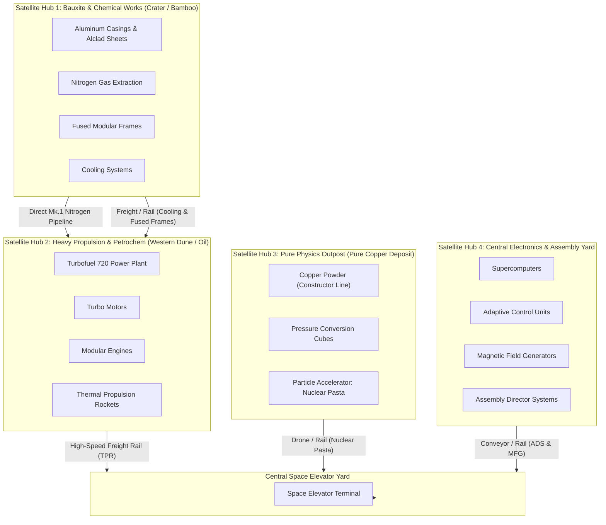

# Satisfactory 1.0 Factory Design Doctrine
## The Whole-Machine Nominal Clocking, Natural Depot Surplus & Zero-Screw Framework

> **Scope**: Universal factory architecture and planning framework for Satisfactory 1.0 saves.  
> **Origin**: Developed in `zinctoniaDos` (Flynn & Shibity) for Phase 4 Space Elevator expansion.  
> **Core Tenet**: *Never underclock a machine to a decimal. Run integer machines at nominal 100%, harvest the delta into Dimensional Depots for construction, and ban screws entirely.*

---

## 1. Executive Summary & Core Rules

Traditional factory planning calculators force lines into fractional machine clocks (e.g., $1\times$ Manufacturer @ 40%, $2\times$ Blenders @ 53.33%) to match exact milestone or Space Elevator input quotas. This introduces three major flaws:
1. **Underutilized Footprint**: Foundations and machines are placed but operate below capacity.
2. **Starved Pioneers**: High-tier building materials (Supercomputers, Turbo Motors, Cooling Systems, Fused Frames) are never available for the build gun because all output is locked to elevator delivery.
3. **Fragile Tuning**: Upstream feeds become awkward decimal rates ($0.75/\text{min}$, $1.125/\text{min}$) that complicate logistics.

This framework replaces fractional throttling with **Whole-Machine Nominal Clocking ($\lceil N \rceil$ @ 100%)** and **Natural Depot Surplus**.

### The 5 Golden Rules
1. **$\lceil N \rceil$ Machine Sizing**: Always round required machine counts UP to the nearest integer ($\lceil N \rceil$). Run every machine at 100% clock speed.
2. **Upstream Fully Sized**: Scale all upstream intermediate lines to satisfy 100% of the downstream machines' nominal intake.
3. **Natural Surplus Harvesting**: Divert the difference between nominal 100% production and project consumption into **Dimensional Depots** and storage.
4. **Sequential Smart Splitters**: Prioritize downstream production first, Dimensional Depots second, local storage third, and AWESOME Sink last.
5. **Zero Screws Doctrine (`--no-screws`)**: Screws are banned from all new production lines. Use alternative recipes across all tiers.

---

## 2. Rule 1: Whole-Machine 100% Nominal Clocking ($\lceil N \rceil$)

When a project milestone demands a fractional production rate, calculate the whole machine ceiling:

$$N_{\text{machines}} = \left\lceil \frac{\text{Required Throughput}}{\text{Nominal Recipe Rate per Machine}} \right\rceil$$

### Example: Phase 4 Space Elevator Targets
| Target Milestone Item | Required Rate | Nominal Machine Output | Whole Machines Clocked @ 100% | Total Nominal Output | Space Elevator Demand | Natural Surplus to Depots |
| :--- | :---: | :---: | :---: | :---: | :---: | :---: |
| **Assembly Director System** | $0.75 / \text{min}$ | $0.75 / \text{min}$ | **$1\times$ Assembler** | $0.75 / \text{min}$ | $0.75 / \text{min}$ | $0.00 / \text{min}$ (Sink on finish) |
| **Thermal Propulsion Rocket**| $1.00 / \text{min}$ | $1.00 / \text{min}$ | **$1\times$ Manufacturer**| $1.00 / \text{min}$ | $1.00 / \text{min}$ | $0.00 / \text{min}$ (Sink on finish) |
| **Magnetic Field Generator** | $1.00 / \text{min}$ | $1.00 / \text{min}$ | **$1\times$ Assembler** | $1.00 / \text{min}$ | $1.00 / \text{min}$ | $0.00 / \text{min}$ (Sink on finish) |
| **Nuclear Pasta** | $0.50 / \text{min}$ | $0.50 / \text{min}$ | **$1\times$ Accelerator** | $0.50 / \text{min}$ | $0.50 / \text{min}$ | $0.00 / \text{min}$ (Sink on finish) |

Because the final project targets are whole numbers, the intermediate tiers naturally produce substantial high-tier build materials.

---

## 3. Rule 2: Natural Surplus Harvesting

Intermediate factory blocks feeding the milestone lines are sized to 100% nominal capacity. Instead of choking machines with clock sliders, the excess production feeds directly into the Pioneer's cloud inventory:

### Intermediate Surplus Yields
| Intermediate Component | Machines @ 100% | Nominal Output | Milestone Consumption | Continuous Natural Surplus | Surplus per Hour | Build Gun Applications |
| :--- | :---: | :---: | :---: | :---: | :---: | :--- |
| **Supercomputer** | $1\times$ Manufacturer | $1.875 / \text{min}$ | $0.75 / \text{min}$ (ADS) | **$+1.125 / \text{min}$** | **$67.5 / \text{hr}$** | Radar Towers, Drones, Geothermal, Quantum Portals |
| **Turbo Motor** | $1\times$ Manufacturer | $1.875 / \text{min}$ | $1.00 / \text{min}$ (TPR) | **$+0.875 / \text{min}$** | **$52.5 / \text{hr}$** | Miner Mk.3, Particle Accelerators |
| **Cooling System** | $2\times$ Blenders | $12.00 / \text{min}$ | $10.50 / \text{min}$ (TPR + TM) | **$+1.50 / \text{min}$** | **$90.0 / \text{hr}$** | Blenders, Drones, Thermal Tech |
| **Fused Modular Frame** | $2\times$ Blenders | $3.00 / \text{min}$ | $2.00 / \text{min}$ (TPR + PCC) | **$+1.00 / \text{min}$** | **$60.0 / \text{hr}$** | Miner Mk.3, Heavy Construction, Portals |
| **Pressure Conversion Cube** | $1\times$ Assembler | $1.00 / \text{min}$ | $0.50 / \text{min}$ (Pasta) | **$+0.50 / \text{min}$** | **$30.0 / \text{hr}$** | Quantum Encoders, Tier 9 Tech |

### Classification of Outputs
Not all excess should enter the cloud:
1. **Tier A (Build Items & Tech)**: Supercomputers, Turbo Motors, Cooling Systems, Fused Modular Frames, Pressure Conversion Cubes, Heavy Modular Frames, Computers, Motors, Reinforced Iron Plates.  
   $\to$ **Route to Dimensional Depots & Storage Crates**.
2. **Tier B (Milestone-Only Parts)**: Smart Plating, Versatile Framework, Modular Engine, Adaptive Control Unit.  
   $\to$ These have zero crafting or building recipes outside the Space Elevator. **Overflow directly to the AWESOME Sink** to generate Coupons without wasting Mercer Spheres on Depots.

---

## 4. Rule 3: The Sequential Smart Splitter Wiring Standard

To prevent Dimensional Depots or storage crates from starving downstream factories, every surplus-capable machine line must implement the **Sequential Smart Splitter Manifold**:

```
[ Factory Machine Output ]
            │
            ▼
   ┌──────────────────┐
   │ Smart Splitter 1 │ ──( Center / Right: Primary Item )──► [ Downstream Assembly / Elevator ]
   └────────┬─────────┘
            │ ( Overflow )
            ▼
   ┌──────────────────┐
   │ Smart Splitter 2 │ ──( Center / Right: Primary Item )──► [ Dimensional Depot Uploader(s) ]
   └────────┬─────────┘
            │ ( Overflow )
            ▼
   ┌────────────────────────────────┐
   │ Industrial Storage Container   │
   └────────┬───────────────────────┘
            │
            ▼
   ┌──────────────────┐
   │ Smart Splitter 3 │ ──( Center / Right: Any Undefined )──► [ Local Access / Mall ]
   └────────┬─────────┘
            │ ( Overflow )
            ▼
   ┌──────────────────┐
   │   AWESOME Sink   │
   └──────────────────┘
```

### Operational Logic
1. **Splitter 1 (Priority 1: Downstream Demand)**: Downstream production receives 100% of required throughput. No surplus is diverted until the downstream input buffer is full.
2. **Splitter 2 (Priority 2: Cloud Depot)**: Excess overflows into the Dimensional Depot until the cloud storage and internal 1-stack uploader buffer are 100% full.
3. **Storage Container (Priority 3: Local Crate Buffer)**: Once the Depot is full, surplus fills an Industrial Storage Container for rapid bulk withdrawal.
4. **Splitter 3 (Priority 4: AWESOME Sink)**: When local crates are completely full, the remaining stream dumps into the AWESOME Sink. **The production line never backs up or halts.**

---

## 5. Rule 4: Save-History-Driven Construction Sizing

Before building a dedicated building-material line, measure actual Pioneer consumption from the save history:

```bash
# Example tool syntax (SatisfactoryMCP / satisfactory-surplus)
uv run python tools/surplus_report.py
```

### Save Analysis Insights
1. **Concrete Dominance**: Concrete consistently accounts for $>50\%$ of all placed buildables across a save's lifetime due to foundation zooping. A single standard constructor ($15/\text{min}$) is perpetually starved during major expansions.
2. **Bandwidth Limits vs. Upload Caps**:
   * Mercer Sphere upload bandwidth upgrades apply **per physical uploader** ($15 \to 30 \to 60 \to 120 \to 240/\text{min}$), NOT globally.
   * High-drain materials (Concrete, Iron Plates, Wire) require **Dual Parallel Depots** fed via a splitter to achieve $2\times$ upload rate during zooping.

### Dedicated Foundation Sizing Standard
* **Concrete**: $1\times$ Refinery on `Wet Concrete` ($80.0/\text{min}$) with **Dual Dimensional Depots**. Consumes 120 Limestone + 100 Water. Eliminates all foundation paving deficits.
* **Encased Industrial Beams**: $1\times$ Assembler on `Encased Industrial Pipe` ($24.0/\text{min}$). Consumes 28 Steel Pipes + 20 Concrete. Eliminates steel beam bottlenecks.
* **Reinforced Plates**: $1\times$ Assembler on `Stitched Iron Plate` ($15.0/\text{min}$). Consumes 18.75 Iron Plates + 37.5 Wire. Zero screws required.

---

## 6. Rule 5: The Strict Zero-Screws Recipe Doctrine (`--no-screws`)

Screws are the #1 logistical point of failure in Satisfactory. They saturate belt capacity (up to 100/min per machine), require disproportionate constructor counts, and create spaghetti logistics.

In this doctrine, screws are **completely banned** from all production designs.

### The Canonical Replacement Matrix
| Component | Default Recipe (With Screws) | Canonical Alternate Recipe | Machines & Ratios | Key Advantages |
| :--- | :--- | :--- | :--- | :--- |
| **Reinforced Iron Plate** | Iron Plates + Screws ($120/\text{min}$) | **Stitched Iron Plate** | Assembler: 18.75 Plates + 37.5 Wire $\to$ 15 Plates/min | 100% screw elimination; pair with Iron Wire for single-ore iron line. |
| **Rotor** | Iron Rods + Screws ($100/\text{min}$) | **Steel Rotor** | Assembler: 10 Steel Pipes + 30 Wire $\to$ 5 Rotors/min | Consolidates stator and rotor manufacturing to shared steel/wire inputs. |
| **Heavy Modular Frame** | Modular Frame + Steel Pipe + Encased Beam + Screws ($200/\text{min}$) | **Heavy Flexible Frame** | Manufacturer: 5 Mod Frames + 3 Encased Beams + 19.5 Rubber $\to$ 3.75 HMF/min | Cuts machine count by 50%; completely bypasses screws and modular frame limits. |
| **Computer** | Circuit Boards + Cable + Plastic + Screws ($130/\text{min}$) | **Caterium Computer** | Manufacturer: 7.5 Circuit Boards + 7 Quickwire + 5.25 Rubber $\to$ 3.75 Comp/min | Drastically simplifies footprint; leverages caterium for high yields. |
| **High-Speed Connector** | Quickwire + Cable + Plastic | **Silicon High-Speed Connector** | Manufacturer: 60 Quickwire + 37.5 Circuit Boards + 22.5 Silica $\to$ 3 HSC/min | Eliminates cable routing; integrates directly with bauxite/silica processing. |

---

## 7. Topology: Modular Satellite Hubs vs. Mega-Monolith

Avoid routing thousands of raw ores across the map into a single mega-monolith factory. Instead, partition production into **Modular Satellite Hubs** placed directly at raw resource nexuses, linked by electric rail, high-pressure pipelines, or drones:



### Hub Allocation Guidelines
1. **Satellite Hub 1 (Chemical & Bauxite)**: Located at high-altitude bauxite and nitrogen wells. Handles water recycling, alumina solution, casing manufacturing, and blenders.
2. **Satellite Hub 2 (Petrochemical & Heavy Propulsion)**: Located at coastal/desert crude oil deposits. Generates Turbofuel grid power and manufactures heavy motors, rubber byproducts, and rockets.
3. **Satellite Hub 3 (Nuclear & Particle Physics)**: Located on a pure copper node. Houses high-drain Particle Accelerators ($250\text{--}1,500\text{ MW}$) and copper powder constructor banks.
4. **Satellite Hub 4 (Central Electronics)**: Centrally situated near Caterium and Quartz. Feeds computers, radio units, and Space Elevator assembly directly.

---

## 8. Checklist for Porting to a New Save

When starting or expanding a factory in a new world, follow this verification checklist:

- [ ] **MAM Hard Drives**: Unlock `Cast Screws` (early) $\to$ `Stitched Iron Plate` + `Iron Wire` (mid) $\to$ `Heavy Flexible Frame` + `Caterium Computer` + `Encased Industrial Pipe` (late).
- [ ] **Save Consumption Check**: Run a surplus audit on the world save to identify the Pioneer's top building material bottlenecks.
- [ ] **Dedicated Wet Concrete**: Drop $1\times$ Refinery on `Wet Concrete` ($80/\text{min}$) with **Dual Parallel Depots**.
- [ ] **Machine Sizing**: Round every milestone production quota up to integer $\lceil N \rceil$ whole machines clocked at 100%.
- [ ] **Upstream Balancing**: Size upstream factories to 100% nominal feed so machines never cycle or starve.
- [ ] **Smart Splitter Standard**: Wire every surplus-capable line as:  
  `Downstream Priority` $\to$ `Dimensional Depot` $\to$ `Industrial Storage` $\to$ `AWESOME Sink`.
- [ ] **No Screws Audit**: Confirm zero screws exist in any bill of materials.
